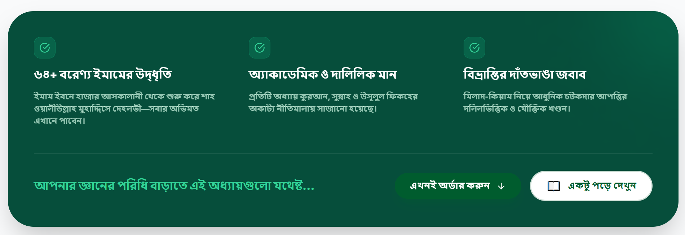

বিভ্রান্তি দূর করুন
মিলাদুন্নবী কি বিদআত? নাকি শত শত বরেণ্য ইমামের সমর্থিত একটি আমল?
৬৪ জন বরেণ্য ইমাম ও মনীষীর দলিলভিত্তিক বিশ্লেষণে জানুন— মিলাদ উদযাপন ও মিলাদ-কিয়ামের প্রকৃত হুকুম কী!

আপনি কি এই দোলাচলে আছেন?

একজন বলে বিদআত, আরেকজন বলে সুন্নাহ—আপনি কার কথা মেনে চলবেন?

দলিল ছাড়া দ্বীনের সিদ্ধান্ত নেবেন—নকি প্রমাণ জেনে নিশ্চিত হবেন?

সবাই কি কুরআন-হাদিসের কথাই বলছে? তাহলে দুই বিপরীত কথা কেন?

বিভ্রান্তির এই যুগে—আপনার আকীদা পরিষ্কার করা এখন আর অপশন না, বরং প্রয়োজন।

৬৪ জন বরেণ্য ইমামের দালিলিক গবেষণা
কুরআন-হাদিস ও উসূলুল ফিকহ ভিত্তিক বিশ্লেষণ
ইতিহাস, সালাফ ও খালাফের নির্ভরযোগ্য পর্যালোচনা
বিভ্রান্তি দূর করে আকীদা পরিষ্কার করার গাইড
৳500
৳800
আপনি পাচ্ছেন 38% ছাড়!

এখনই অর্ডার করুন
ক্যাশ অন ডেলিভারি
সারা বাংলাদেশে ডেলিভারি
৩-৫ দিনে হাতে পাবেন
সতর্ক থাকুন
আজ আপনি কোথায় দাঁড়িয়ে আছেন— একবার ভেবেছেন কি?
এক আলেম বলেন: "মিলাদ বিদআত", আরেকজন বলেন: "এটা সুন্নাহ ও ভালো কাজ"। দুই বিপরীত কথা—কিন্তু দু’জনই কুরআন-হাদিসের কথা বলছেন! তাহলে সত্যটা কোথায়?

১
চরম বিভ্রান্তি ও মতবিরোধ
একদল বলছে 'সুন্নাহ', অন্যদল বলছে 'বিদআত'। এই পরস্পরবিরোধী বক্তব্যের মাঝে সাধারণ মানুষ আজ দিশেহারা।

২
অন্ধ অনুসরণের ঝুঁকি
দলিল ছাড়া শুধু হুজুরের কথায় আমল করা কি নিরাপদ? কিয়ামত দিবসে কি 'শুনেছি' বলে পার পাওয়া যাবে?

৩
আকীদা ও আমলের নিরাপত্তা
একটি ভুল বিশ্বাস বা আমল আপনার সারাজীবনের ইবাদতকে প্রশ্নবিদ্ধ করতে পারে। সত্য জানা এখন জরুরি।

নিজেকে এই প্রশ্নগুলো একবার করুন—

আমি যা করছি—এটা কি সত্যিই সহীহ?

আমি কি অন্ধভাবে কারো অনুসরণ করছি?

ভুল আকীদা নিয়ে জীবন কাটাচ্ছি না তো?

ইউটিউব-ফেসবুকের তর্কে সত্য হারিয়ে যাচ্ছে না তো?

পরকালে আমল কবুল না হলে উপায় কী?

দলিল ছাড়া দ্বীনের ওপর চলা কি সম্ভব?

— এই বিভ্রান্তির অন্ধকার থেকে বের হতে হলে—

আপনার দরকার মতামত নয়, বরং অকাট্য দলিল ও নির্ভরযোগ্য ইতিহাস।

যদি সত্য না জানেন—
অজান্তেই কোনো ভ্রান্ত মতবাদের ওপর দাঁড়িয়ে থাকবেন যা আপনার আমলী ও আকীদা-গত ঝুঁকি তৈরি করছে।
দ্বীনের গুরুত্বপূর্ণ বিষয়ে দলিল ছাড়া লোকমুখে শোনা কথার ওপর আমল করে যাবেন।
রাসূল ﷺ-এর প্রতি ভালোবাসার সহীহ এবং ভারসাম্যপূর্ণ চিত্রটি আপনার কাছে অজানাই থেকে যাবে।
যদি বইটি পড়েন—
মিলাদ-কিয়াম নিয়ে আপনার মনে থাকা সব দ্বিধা ও সংশয় ধূলিসাৎ হবে ইনশাআল্লাহ।
৬৪ জন বরেণ্য ইমামের দালিলিক প্রমাণের ওপর ভিত্তি করে আপনার বিশ্বাসকে সুদৃঢ় করতে পারবেন।
নবীর ﷺ প্রতি ভালোবাসার এই আবেগগুলোকে দলিল দিয়ে শানিত ও শক্তিশালী করতে পারবেন।
সিদ্ধান্ত এখন আপনার
প্রামাণ্য গবেষণা নিয়ে সত্য আঁকড়ে ধরবেন, নাকি শোনা কথায় ভাসবেন?

এখনই অর্ডার করুন

📖
একটু পড়ে দেখুন
অকাট্য প্রামাণ্য দলিল
এই বই শুধু তথ্য নয়—এটি আকীদা পরিষ্কার করার নির্ভরযোগ্য গাইড
এই বইটা না নিলে আপনি আসলেই একটি গভীর গবেষণালব্ধ কাজ মিস করবেন। ৪৪৯ পৃষ্ঠার এই গ্রন্থে ধাপে ধাপে একটি বিতর্কিত বিষয়কে খুলে দেখানো হয়েছে দলিল, ইতিহাস ও ইমামদের বক্তব্য দিয়ে।

৪৪৯

পৃষ্ঠার গভীর গবেষণা

৬৪+

বরেণ্য ইমামের মতামত

১০০%

রেফারেন্সভিত্তিক আলোচনা

সহজ

সাবলীল বাংলা ভাষা

পড়ার পর আপনার ভাবনা—
আর কোনো দ্বিধা থাকবে না
প্রকৃত সত্য যাচাই করতে পারবেন
আত্মবিশ্বাসের সাথে অবস্থান ব্যাখ্যা করতে পারবেন
অজ্ঞতা কাটিয়ে নিশ্চিত জ্ঞান অর্জন করবেন
বইয়ের ভেতরের বিশেষ চ্যাপ্টারসমূহ—

1
১. "বিদআত" আসলে কী? (মূল ভিত্তি)
— বিদআতের প্রকৃত সংজ্ঞা কী? সব নতুন জিনিসই কি বিদআত?

— "کل بدعة ضلالة" হাদিসের সঠিক ব্যাখ্যা কী?

ফলশ্রুতি:এই অধ্যায় না বুঝলে—পুরো বিতর্কই ভুলভাবে বুঝবেন। বিদআতের প্রকৃত ধারণা এখানে স্পষ্ট করা হয়েছে।

2
২. উসূলুল ফিকহের আলোকে বিশ্লেষণ
— ইবাদতের ক্ষেত্রে কিয়াস কীভাবে কাজ করে?

— "الأصل في العبادة التوقيف" এর প্রকৃত অর্থ কী?

ফলশ্রুতি:যারা যুক্তি দিয়ে বিষয়টি বুঝতে চান—এই তাত্ত্বিক আলোচনা তাদের জন্য চোখ খুলে দেবে।

3
৩. ইতিহাসে মিলাদ উদযাপনের বাস্তবতা
— প্রথম কবে মিলাদ শুরু হয় এবং কোন অঞ্চলে প্রচলিত হয়?

— ইতিহাসের বিখ্যাত আলেমরা কীভাবে এটি মূল্যায়ন করেছেন?

ফলশ্রুতি:শুধু মতামত নয়—প্রমাণসহ ঐতিহাসিক ধারাবাহিকতা এখানে তুলে ধরা হয়েছে।

4
৪. ৬৪ জন বরেণ্য ইমামের স্পষ্ট মতামত
— বিভিন্ন যুগের ফকীহ, মুহাদ্দিস ও মুজতাহিদদের অভিমত কী?

— একই মলাটে এত বিশাল স্কেলের দলিল কি আর কোথাও পাওয়া সম্ভব?

ফলশ্রুতি:বইটির সবচেয়ে শক্তিশালী অংশ। বড় বড় ইমামদের বক্তব্য একত্রে এবং রেফারেন্সসহ দেওয়া হয়েছে।

5
৫. মিলাদ উদযাপনের পক্ষে শক্তিশালী দলিল
— কুরআন ও সহীহ হাদিস থেকে কী কী প্রমাণ রয়েছে?

— ইমামদের ইজতিহাদ ও দলিলভিত্তিক আলোচনার গভীরতা কতটুকু?

ফলশ্রুতি:শুধু আবেগ নয়—প্রমাণের ওপর দাঁড়িয়েই এই আমলটির গ্রহণযোগ্যতা প্রমাণিত।

6
৬. আপত্তি ও তার জবাব (Game Changer)
— "মিলাদ বিদআত"—এই দাবির তাত্ত্বিক জবাব কী?

— বিরোধীদের মূল যুক্তিগুলো কেন দালিলিকভাবে টিকছে না?

ফলশ্রুতি:এই অংশটি পড়ার পর আপনি শুধু নিজের জন্য নয়—অন্যদেরও উত্তর দিতে পারবেন।

7
৭. মিলাদ-কিয়ামের বাস্তব চিত্র
— মিলাদ-কিয়াম আসলে কী? এর ভেতরের কার্যক্রম কী কী?

— কেন মানুষ দাঁড়ায় (কিয়াম)? এটি কি বাধ্যতামূলক?

ফলশ্রুতি:যে বিষয়টি নিয়ে সবচেয়ে বেশি বিতর্ক—এখানে তার পরিষ্কার ও সহজ ব্যাখ্যা দেওয়া হয়েছে।

8
৮. ভুল মিলাদ বনাম সহীহ মিলাদ
— কোন মিলাদ গ্রহণযোগ্য এবং কোন কাজগুলো পরিত্যাজ্য?

— সীমা কোথায় টানতে হবে? ভারসাম্যপূর্ণ দৃষ্টিভঙ্গি কোনটি?

ফলশ্রুতি:Blind support নয়—বরঞ্চ প্রামাণ্য এবং ভারসাম্যপূর্ণ এক উপলব্ধি এখানে পাবেন।

এই বইয়ের বিশেষ বৈশিষ্ট্য
✓
৬৪ জন স্বীকৃত ইমামের রেফারেন্স:
একই বিষয়ের ওপর এত বৃহৎ কলেবরে ইমামদের মতামত সংকলন বিরল।
✓
নিরপেক্ষ ও তাত্ত্বিক বিশ্লেষণ:
কোনো একপক্ষকে সমর্থন নয়, বরং দলিলের ভিত্তিতে কোনটি হক তা তুলে ধরা হয়েছে।
✓
সহজ ও প্রাঞ্জল উপস্থাপনা:
জটিল তাত্ত্বিক ও ফিকহী বিষয়গুলোকে সাধারণ পাঠকের বোঝার উপযোগী করে লেখা।
✓
বিভ্রান্তি নিরসনে ধ্রুবতারা:
মিলাদ-কিয়াম নিয়ে আপনার মনে থাকা সব প্রশ্নের উত্তর এখানে পাবেন।

এখনই অর্ডার করুন

📖
একটু পড়ে দেখুন
সত্যিকারের পরিবর্তন বোঝা যায়—
যখন মানুষ নিজের অভিজ্ঞতা শেয়ার করে
এই বই শুধু তাত্ত্বিক আলোচনা নয়, এটি মানুষের আমলী ও আকীদাগত জীবনে এক গভীর প্রশান্তি আনতে সক্ষম হয়েছে।

“মিলাদ নিয়ে সব বিভ্রান্তি দূর হয়েছে”
আগে এক হুজুর বলতেন বিদআত, আরেক হুজুর সুন্নাহ। এই বইয়ের ৬৪ জন ইমামের দলিল পড়ার পর আমার সব দ্বিধা দূর হয়ে গেছে। এখন আমি নিশ্চিত হয়ে আমল করতে পারি।

“তাত্ত্বিক ও দালিলিক এক অসাধারণ বই”
৪৪৯ পৃষ্ঠার এই বইয়ে কুরআন-হাদিস ও উসূলুল ফিকহের আলোকে যে বিশ্লেষণ দেওয়া হয়েছে, তা সচরাচর পাওয়া যায় না। সত্য জানতে হলে এই বইটি পড়া সবার জন্য জরুরি।

“রাসূল ﷺ-এর প্রতি ভালোবাসার সহীহ রূপ”
ভালোবাসা কি শুধু মুখে? নাকি দলিলের ওপর দাঁড়িয়ে? এই বইটি পড়ার পর নবীর ﷺ স্মরণে খুশি হওয়ার আমলী হুকুমটি আমার কাছে আয়নার মতো পরিষ্কার হয়ে গেছে।

“আপনার আকীদা পরিষ্কার করার শ্রেষ্ঠ গাইড”
শুনেছি নয়, প্রমাণ দেখে সিদ্ধান্ত নিন। এই বইতে শুধু একপক্ষের কথা বলা হয়নি, বরং দলিল দিয়ে নিরপেক্ষভাবে বিষয়টি বুঝিয়ে দেওয়া হয়েছে।

এই বিভ্রান্তির শেষ কোথায়? উত্তর একটাই—
মতামত নয়, দলিল জানতে হবে।
আর সেই দলিল জানাবে—

বরেণ্য ইমাম ও মনীষীদের দৃষ্টিতে মিলাদুন্নবী উদযাপন ও মিলাদ-কিয়াম
জুবাইর আহমাদ | সিদ্দীকিয়া প্রকাশনী

৬৪+

বরেণ্য ইমামের মতামত

৪৪৯

পৃষ্ঠার গভীর গবেষণা

১০০%

রেফারেন্সভিত্তিক আলোচনা

নিরপেক্ষ

তাত্ত্বিক বিশ্লেষণ

কেন এই বইটি আপনার জন্য অপরিহার্য—
৬৪ জন ইমামের মতামত
বিভিন্ন যুগের বরেণ্য মুহাদ্দিস, ফকীহ ও মুজতাহিদদের স্পষ্ট বক্তব্য একত্রে এবং রেফারেন্সসহ দেওয়া হয়েছে।

উসূলুল ফিকহ বিশ্লেষণ
ইবাদতের মূলনীতি ও শরয়ী কায়েদার আলোকে বিষয়টি তাত্ত্বিকভাবে বিশ্লেষণ করা হয়েছে।

ঐতিহাসিক ধারাবাহিকতা
ইতিহাসে মিলাদ উদযাপনের উৎপত্তি এবং মুসলিম উম্মাহর ঐতিহ্যের প্রামাণ্য ইতিহাস।

আপত্তি ও জবাব
বিরোধীদের যুক্তিও তুলে ধরে দলিল দিয়ে সেগুলো খণ্ডন করা হয়েছে, যাতে আপনি নিজেই সিদ্ধান্ত নিতে পারেন।

বইটি আপনাকে যা দেবে:

মিলাদ বিদআত কিনা—স্পষ্ট বুঝতে সাহায্য করবে

মিলাদ-কিয়ামের প্রকৃত হুকুম জানতে পারবেন

সালাফ ও খালাফের সঠিক অবস্থান বুঝতে পারবেন

বিভ্রান্তি থেকে বের হয়ে নিশ্চিত হতে পারবেন

সিদ্ধান্ত আপনার—

আপনি কি শোনা কথার ওপর ইবাদত গড়বেন?

নাকি প্রমাণের ওপর দাঁড়িয়ে নিশ্চিত হবেন?

আপনার দ্বীনের মতো গুরুত্বপূর্ণ বিষয়ে— অনুমান নয়, প্রমাণের ওপর দাঁড়ান।

এখনই অর্ডার করুন

📖
একটু পড়ে দেখুন
সঠিক দলিল জানার জন্য—
দেরি করাটাই সবচেয়ে বড় ক্ষতি
সত্য জানার সুযোগ বারবার আসে না। এই ৪৪৯ পৃষ্ঠার গবেষণাগ্রন্থটি আপনার আকীদা ও আমলী সচেতনতার পাথেয় হতে পারে।

সীমিত সময়ের অফার
আজই কেন সংগ্রহ করবেন?
প্রথম ৫০ জনের জন্য বিশেষ ছাড় প্রযোজ্য
সারা বাংলাদেশে ক্যাশ অন ডেলিভারি সুবিধা
প্রতিটি বইয়ের সাথে একটি আকর্ষণীয় ফ্রি বুকমার্ক
বই হাতে পেয়ে চেক করে পেমেন্ট করার সুযোগ
হোম ডেলিভারি
১০০% অরিজিনাল বই
আপনার বিনিয়োগ

৳500
৳800
আপনি পাচ্ছেন 38% ছাড়!

এখনই অর্ডার করুন

📖
একটু পড়ে দেখুন

- স্টক ফুরিয়ে যাওয়ার আগেই আপনার কপিটি নিশ্চিত করুন

একটু ভেবে দেখুন—

— একবেলার নাস্তার টাকা আমরা অযথাই খরচ করে ফেলি।

— কিন্তু এই সামান্য বিনিয়োগ কি আপনার আজীবনের আকীদা ও আমলকে সংশয়মুক্ত করার জন্য যথেষ্ট নয়?

সাধারণ জিজ্ঞাসাসমূহ
বইটি সম্পর্কে আপনার মনে থাকা কিছু প্রশ্নের উত্তর

এই বইটি কি কোনো একপক্ষকে সমর্থন করে লেখা?

মিলাদ-কিয়াম নিয়ে তো অনেক আলোচনা শুনেছি, এই বইয়ে নতুন কী আছে?

আমি আলেম নই, আমি কি এই তাত্ত্বিক বই বুঝতে পারবো?

এই বিষয়টি কি সত্যিই আমার জন্য এত গুরুত্বপূর্ণ?

অর্ডার করার কতদিনের মধ্যে বই হাতে পাবো?
ডেলিভারি ঠিকানা
নাম*
Md. Mustaqim Khan
মোবাইল নম্বর *
01728781726
ঠিকানা \*
hsgsggdfs
নোট (ঐচ্ছিক)
কোনো নির্দিষ্ট নির্দেশনা থাকলে লিখুন...
পেমেন্ট পদ্ধতি

আপনার অর্ডার
Thumbnail
বরেন্য ইমাম ও মনীষীদের দৃষ্টিতে মিলাদুন্নবী উদযাপন ও মিলাদ-কিয়াম
স্টক আছে
সীমিত অফার চলছে!

পরিমাণ:

1

৳500

৳800
ডেলিভারি এলাকা

সরাসরি কথা বলুন
অর্ডার করতে কোনো সমস্যা হলে নিচের নাম্বারে সরাসরি কল করুন

০১৬০২-৪৩১১৬৭
শেষ কথা — সিদ্ধান্ত এখন আপনার
অজ্ঞতা কখনো
অজুহাত হতে পারে না
যে বিষয়টি আপনার সারাজীবনের আমল ও আকীদার সাথে সরাসরি সম্পৃক্ত—তা কি আপনি সংশয় নিয়ে করতে পারেন?

সত্য না জানলে—
চিরকাল সংশয়ের মধ্যেই থেকে যাবেন।
ভুল আমল করার চরম ঝুঁকির মধ্যে থাকবেন।
ভ্রান্ত প্রচারণার স্রোতেই গা ভাসিয়ে চলবেন।
সত্য জানলে—
দলিলভিত্তিক আমল করে প্রশান্তি অর্জন করবেন ইনশাআল্লাহ।
যেকোনো বিভ্রান্তিকর প্রশ্নের সামনে দালিলিক উত্তর দিতে পারবেন।
ঈমানি শক্তি ও আকীদাগত দৃঢ়তা অনুভব করবেন।
সত্যকে জানুন। আপনার ইবাদতকে সংশয়মুক্ত করুন।
মাত্র ৮২০ টাকা বিনিয়োগে আপনার আকীদা পরিষ্কার করার এই সুযোগটি হাতছাড়া করবেন না।

এখনই অর্ডার করুন
ক্যাশ অন ডেলিভারি
সারাদেশে ডেলিভারি
সীমিত স্টক

